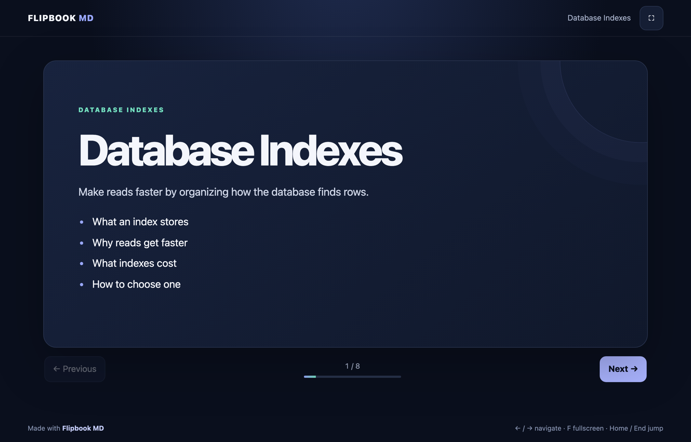
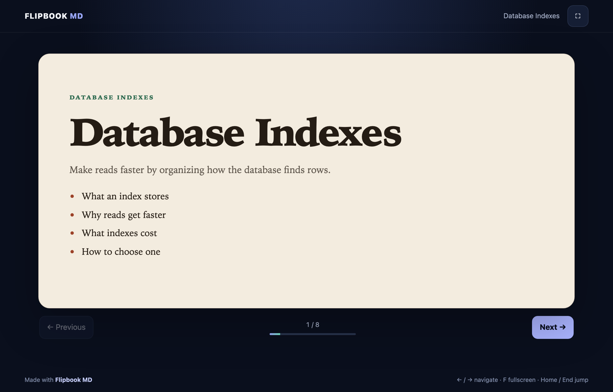
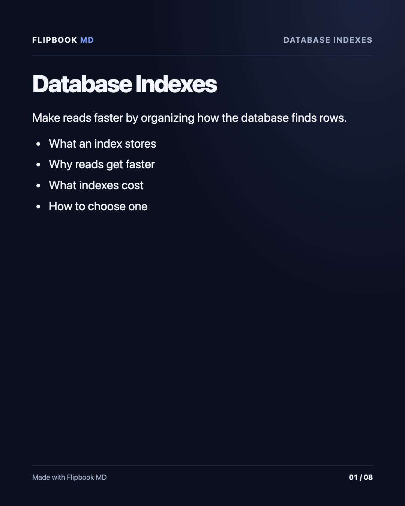
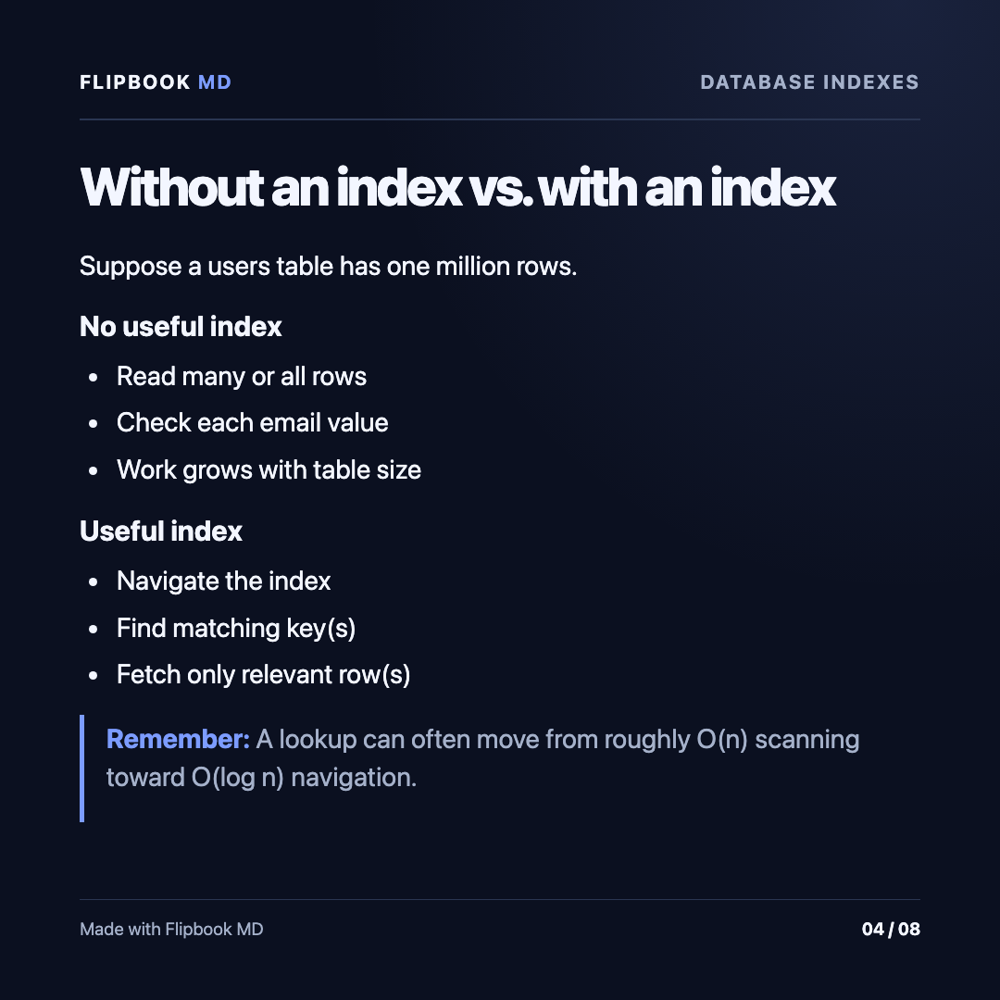

# Flipbook MD

[](https://github.com/uminocelo/flipbook-md/actions/workflows/ci.yml)

**Markdown in. Slides out.**

Flipbook MD is a local command-line tool. Point it at a Markdown presentation and it serves a slide player in your browser, with a separate announcer view for speaker notes. The same source can be exported as numbered PNG images for a multi-image post on Instagram, X, LinkedIn, YouTube, or TikTok, or as one MP4.



The shot above is `examples/database-indexes-project` in the browser player.

Requires [Node.js](https://nodejs.org/) 20 or newer.

## Install

```sh
npm install -g flipbook-md
flipbook show .
```

`flipbook show` serves a presentation in the current directory. [Write a presentation](#write-a-presentation) describes the file format. Flipbook prints a `http://127.0.0.1` URL and tries to open it in your default browser. If it cannot, open the printed URL yourself. Press Ctrl+C to stop the server.

Exporting slides needs Chromium, installed once:

```sh
npx playwright install chromium
```

Video export also needs [ffmpeg](https://ffmpeg.org/) on your `PATH`.

## Quick start from a checkout

Clone this repository, install dependencies, and open the sample talk:

```sh
npm install
npm start
```

`npm start` serves `examples/database-indexes-project` on a local URL, the same way `flipbook show` does.

To use the `flipbook` command from any directory while you work on this repository:

```sh
npm link
flipbook show examples/database-indexes-project
```

Without a global link, run the entry point directly:

```sh
node bin/flipbook.js show .
```

## Commands

| Command | What it does |
| --- | --- |
| `flipbook show [path]` | Serves the presentation on `127.0.0.1`, prints the announcer URL, and opens the deck in a browser. |
| `flipbook check [path]` | Checks an optional `blueprint.yml`. Exits 0 when that file is absent or the deck passes. Exits 1 when a rule fails. |
| `flipbook template add <name> --column <n> --row <n> --width <n> --height <n> --align start\|center\|end` | Saves one grid placement into the deck and into `~/Documents/flipbook/templates/`. |
| `flipbook export [path]` | Writes one PNG per slide, or an MP4 when the format is `video`. |
| `flipbook --help` | Prints usage. |

Omit `path` to use the current directory. `show`, `check`, and `export` accept:

- a `*.slide.md` file
- a directory that contains a `*.slide.md` file
- a directory that contains `presentation.yml`
- a path to `presentation.yml`

A directory with no manifest uses the first `*.slide.md` file in that directory, in sorted name order. Subdirectories are not searched.

## Write a presentation

### Single file

Name the file with a `.slide.md` suffix. YAML frontmatter is optional and sets the title and theme. A line that contains only `---` separates slides. The first separator is the `---` after the frontmatter.

```markdown
---
title: "My presentation"
theme: "midnight"
---

# Hello, world!

Markdown becomes a slide.

---

# Second slide

- Write familiar Markdown
- Separate slides with a line containing only `---`
```

```sh
flipbook show intro.slide.md
```

### Directory

Use one Markdown file per slide and list those files in `presentation.yml`.

```text
my-talk/
├── presentation.yml
├── presentation.css
├── assets/
│   └── diagram.png
└── slides/
    ├── 01-intro.slide.md
    └── 02-next.slide.md
```

`presentation.css` and `assets/` are optional. Slides use the built-in palette when the stylesheet is absent. A manifest may list any Markdown file inside the deck; `slides/NN-name.slide.md` is the convention. Existing decks that list `slides/01-intro.md` keep working.

```yaml
title: "My presentation"
theme: "midnight"
slides:
  - slides/01-intro.slide.md
  - slides/02-next.slide.md
```

```sh
flipbook show ./my-talk
```

Each slide path must stay inside the presentation directory. Flipbook rejects a manifest path that escapes the project, including a path that resolves outside it through a symlink.

The same directory can also hold one `<name>.slide.md` with every slide in a single file. `flipbook show` on the directory uses `presentation.yml` when that file is present.

### Slide templates

A slide can place its body on a 3×3 grid. Omit the template and the slide keeps the current block layout. That default is named `flow`.

Set the name in YAML frontmatter or with a comment. When both are set, frontmatter wins. The comment is not rendered.

```markdown
---
template: cover
---

# Title
```

```markdown
<!-- template: cover -->

# Title
```

`cover` places the body in the center cell and centers it. `summary` places the body in the lower-right four cells, rows 2–3 and columns 2–3. `flow` does not use the grid.

A name that Flipbook does not know fails the load and names the slide. A deck can add names in `templates.yml`. Each name is one region on the same grid, with `column`, `row`, `width`, `height`, and `align` (`start`, `center`, or `end`). `column` and `row` start at 1. The region stays inside the grid. `flow`, `cover`, and `summary` cannot be replaced.

```sh
flipbook template add quote --column 1 --row 2 --width 2 --height 1 --align start
```

Run that command in the deck directory. It writes the `quote` key into `templates.yml` and saves the same fields as `~/Documents/flipbook/templates/quote.yml`. `show` and `export` read the deck file. They do not read the home folder. A slide then uses `<!-- template: quote -->`.

A template name may also include `_`. Names such as `marvel_content_character_cover` are valid. `flow`, `cover`, and `summary` stay reserved.

### Template groups

A group is a saved kit: slide templates, a blueprint, page chrome, and a list of themes. Set `group` in `presentation.yml` or in a single-file frontmatter. Flipbook reads `~/Documents/flipbook/templates/<group>.yml` and, if that file is missing, the built-in copy.

```yaml
title: "Iron Fist"
group: marvel_content_character
style: marvel-jarvis
theme: midnight
slides:
  - slides/01_cover.slide.md
  - slides/02_toc.slide.md
```

`style` loads `~/Documents/flipbook/themes/<style>.css` when the deck has no `presentation.css`. `theme` is still the export backdrop (`midnight`, `light`, `paper`, or `forest`). A deck `templates.yml` or `blueprint.yml` replaces the group entries it defines.

The built-in Marvel kits are `marvel_content_character`, `marvel_content_guide`, `marvel_content_place`, and `marvel_content_item`. Each one uses the same four themes: `marvel-ultron`, `marvel-jarvis`, `marvel-herbie`, and `marvel-sentinel`.

| Group | Pages |
| --- | --- |
| `marvel_content_character` | Cover with a title and image, a table of contents, then any mix of short topics (3), medium topics (5), a media page, a quote, and a callout. |
| `marvel_content_guide` | Cover with a title and image, then timeline pages of at most 5 stops. |
| `marvel_content_place` | Cover, table of contents, then one content page per place. |
| `marvel_content_item` | Cover, table of contents, then one content page per item. |

Directory slides take their page type from the filename suffix: `slides/03_topics-short.slide.md` is type `topics-short`. A single-file deck sets `<!-- type: topics-short -->` on each slide.

A media page has a frame for one image or GIF. Once that image is on the page, the page holds at most 2 topics. A quote page is a blockquote. A callout page uses one of these labels, and the same labels also work inside a content page. The label on the slide is the word in the deck, so a Portuguese deck uses the Portuguese word.

| English | Portuguese |
| --- | --- |
| `Tip` | `Dica` |
| `Reminder` | `Lembrete` |
| `Learn more` | `Saiba mais` |
| `Next` | `A seguir` or `Próximo` |
| `CTA` | `CTA` |
| `Remember` | `Lembre-se` |

```markdown
> **Dica:** Comece pela edição de origem.

> **Lembrete:** Com um GIF na página, no máximo 2 tópicos.

> **Saiba mais:** Nomeie o próximo quadrinho, episódio ou jogo.

> **Lembre-se:** A centelha é um propósito, não só sobreviver.
```

Every group draws the same kind of chrome, with its own corner, line, and shapes. The cover does not show a page counter. Later pages number from 01. The counter sits in one corner for the whole deck. Its line is `solid`, `dashed`, or `dotted`, aligned to the `top`, `middle`, or `bottom` of the number, and its length is `100%` or a shorter value such as `46%`. `ornament` is a short glyph or a small image or GIF at the opposite end of the line, drawn at the same height as the number.

A header and a footer are each a line (`straight`, `dashed`, or `dotted`) or a row of shapes: `circle`, `triangle`, `square`, `pentagram`, `hexagram`, `heptagram`, `octagram`, or `nonagram`.

Override the group chrome in the deck:

```yaml
chrome:
  counter:
    corner: top-left
    line: dotted
    line_align: top
    line_length: 100%
    ornament: assets/mark.gif
  header:
    kind: shapes
    shape: circle
  footer:
    kind: line
    line: dashed
```

### Blueprint

`blueprint.yml` is optional and sits next to `presentation.yml`. No file means no checks. Flipbook does not write the slide prose.

```yaml
pages:
  - type: cover
  - type: point
    repeat:
      min: 3
      max: 6
  - type: conclusion
types:
  cover:
    template: cover
  point:
    allow: [heading, paragraph, list]
  conclusion:
    template: summary
    allow: [heading, paragraph]
    max_chars: 250
```

The `conclusion` type allows only a heading and a paragraph, and at most 250 characters of visible text. Markdown markers are not counted.

Each type can set these rules. A `pages` step can override any of them except `template` for the slides it matches.

| Rule | Meaning |
| --- | --- |
| `template` | Grid placement the slide must use. A slide that sets none inherits it. |
| `allow` | The only content kinds the slide may contain. |
| `forbid` | Content kinds the slide may not contain. |
| `require` | Content kinds the slide must contain, each at least once. |
| `max_chars` | Maximum visible characters on the slide. |
| `max_items` | Maximum top-level list items on the slide, across all its lists. Nested items are not counted. |

The kinds are `heading`, `paragraph`, `list`, `code`, `image`, `blockquote`, and `table`.

```yaml
types:
  summary:
    allow: [heading, list, table]
    require: [list]
  development:
    allow: [heading, paragraph, list]
    max_items: 5
```

The page type of a directory slide is the `_<type>` suffix before `.slide.md`. `slides/01_cover.slide.md` is type `cover`. `nameofdeck_conclusion.slide.md` is type `conclusion`. `slides/01-intro.slide.md` has no type. When the filename and a comment disagree, the filename wins.

A single-file deck sets the type on each slide, because one filename cannot type every slide:

```markdown
<!-- type: conclusion -->
<!-- template: summary -->

# The ask

One short paragraph.
```

```sh
flipbook check examples/blueprint-talk
```

`flipbook check [path]` exits 0 when `blueprint.yml` is absent and when the deck matches. It exits 1 when a rule fails and prints each violation. `flipbook show` and `flipbook export` refuse a deck that fails the same check.

`examples/blueprint-talk` is a five-slide deck that passes. Its cover uses `cover`, its conclusion uses `summary`, and three point slides sit between them.

### Images and other files

Put images, PDF, audio, and video in `assets/` at the deck root. In a slide, path them from that root:

```markdown


[Handout](assets/handout.pdf)
```

A path that starts with `./` is read next to that slide file. `https://` URLs stay as written. Flipbook serves these files with the deck and embeds images in exported PNGs. A file that resolves outside the deck is not served.

### Themes

`theme` may be `midnight` (the default), `light`, `paper`, or `forest`. Image export uses that palette for the slide when `presentation.css` is absent. Any other value falls back to `midnight`. The browser player’s page chrome uses its built-in dark appearance.

### Custom theme

Place `presentation.css` next to `presentation.yml`, or in the same directory as a `.slide.md` file. Flipbook applies it to the slide surface in the browser and in exported images.

```css
:host {
  --slide-bg: #f3ecdf;
  --slide-text: #241c14;
  --slide-muted: #5e564c;
  --slide-accent: #9c4228;
  --slide-mint: #2d6a4f;
  --slide-heading: #241c14;
  --slide-line: #e4d8c8;
  --slide-code: #fffaf3;
  font-family: "Iowan Old Style", Palatino, Georgia, serif;
}

:host::after { content: none; }
```

`:root` in this file is applied to the slide. These variables paint the surface:

| Variable | Role |
| --- | --- |
| `--slide-bg` | Background |
| `--slide-text` | Titles and default type |
| `--slide-muted` | Body copy |
| `--slide-accent` | List markers and links |
| `--slide-mint` | Eyebrow |
| `--slide-heading` | Third-level headings |
| `--slide-line` | Borders |
| `--slide-code` | Code background |

A solid background can hide the default ring with `:host::after { content: none; }`. Local fonts and images referenced with relative `url()` are read from the presentation directory (`.woff2`, `.png`, `.svg`, and the other common font and image types).

The previous, play, and next buttons, the fullscreen button, and the keys ←, →, Space, P, F, and Esc keep the player stylesheet. Esc leaves fullscreen.



## Present

The server binds to `127.0.0.1` and lets the operating system choose a free port. `flipbook show` prints two URLs and opens the deck. Open the announcer URL in a second tab when you are the speaker.

| View | URL | What it shows |
| --- | --- | --- |
| Deck | `http://127.0.0.1:<port>/` | The slides for the room |
| Announcer | `http://127.0.0.1:<port>/announcer` | The same slide, plus a notes panel |

The two tabs stay on the same slide. Press Play in either tab and the other follows. Playback stops on the last slide. It does not loop. The tab where you pressed Play owns the timer, so the slides advance once. Previous, next, Home, and End in either tab move both views. The top bar link opens the other view in a new tab, so the one you are presenting stays put.

| Key | Action |
| --- | --- |
| → or Space | Next slide |
| ← | Previous slide |
| P | Play or pause |
| Home / End | First or last slide |
| F | Toggle fullscreen |
| Esc | Leave fullscreen |

The on-screen buttons perform the same navigation. Play is disabled on the last slide until you move back.

How long Play holds each slide comes from `presentation.interval` in `configuration.yml`. The default is 5 seconds. That interval is separate from a video export's duration.

### Transitions

By default a slide change is instant. Set `presentation.transition` in `configuration.yml` to `fade` or `slide` and the new slide animates in, in the deck and in the announcer view. With `slide`, the new slide comes in from the right when you move forward and from the left when you move back. `presentation.transition_duration` is the length in seconds, greater than 0 and at most 5. The default is 0.4.

```yaml
presentation:
  transition: fade
  transition_duration: 0.4
```

The player skips the animation when the system asks for reduced motion.

### Speaker notes

Notes are not drawn on the audience slide. They show in the announcer panel. A slide with no notes says "No notes for this slide."

In a directory slide, put them in frontmatter:

```markdown
---
notes: |
  Point at the diagram, then go on.
---

# Diagram
```

In any slide, a comment works too. This is the form to use in a single `.slide.md` file:

```markdown
<!-- notes:
Point at the diagram.
Name the tradeoff before the next slide.
-->
```

A slide can use both. The frontmatter note comes first. A line that is only `---` inside a notes comment stays in the note. It does not start a new slide, and it shows as a divider, not as a heading for the line above it. Notes are Markdown, and Flipbook sanitizes them the same way it sanitizes a slide.

## Export carousel images

Export renders each slide with [Playwright](https://playwright.dev/) and Chromium. Install that browser once, after the project dependencies:

```sh
npm install
npx playwright install chromium
```

```sh
# Instagram portrait, 1080 × 1350 (4:5)
flipbook export examples/system-design.slide.md --format carousel --preset instagram

# Square images for X, 1080 × 1080 (1:1)
flipbook export examples/system-design.slide.md --format carousel --preset x

# LinkedIn landscape or link preview, 1200 × 627 (1.91:1)
flipbook export examples/system-design.slide.md --format carousel --preset linkedin-landscape

# TikTok vertical, 1080 × 1920 (9:16)
flipbook export examples/system-design.slide.md --format carousel --preset tiktok

# Choose the output folder
flipbook export . --format carousel --preset instagram --output dist/instagram
```

| Preset | Size | Shape | Intended use |
| --- | ---: | --- | --- |
| `instagram` | 1080 × 1350 | 4:5 portrait | Instagram carousel |
| `x` | 1080 × 1080 | 1:1 square | X multi-image post |
| `linkedin` | 1080 × 1350 | 4:5 portrait | LinkedIn post; uses the most mobile feed space |
| `linkedin-square` | 1080 × 1080 | 1:1 square | LinkedIn post |
| `linkedin-landscape` | 1200 × 627 | 1.91:1 landscape | LinkedIn shared image or link preview |
| `youtube` | 1080 × 1080 | 1:1 square | YouTube community post |
| `tiktok` | 1080 × 1920 | 9:16 vertical | TikTok photo post; fills the screen without bars |

`flipbook --help` lists the same presets. Type and spacing scale with the image: `linkedin-landscape` uses smaller type so a slide fits in 627 pixels, and `tiktok` uses larger type to fill the tall frame. TikTok also accepts 1:1 and 4:5 posts, so `x` and `instagram` work there too.

Export warns when a slide's content does not fit the image and is cut off, and names the slide. Shorten that slide or choose a taller preset.

`--format` accepts `carousel` or `video`. The default format is `carousel`, the default preset is `instagram`, and the default output directory is `dist/carousel` for images or `dist/video` for an MP4.

Each file is named in slide order, for example `01-hello-world.png`. The folder also contains `README.txt`. Upload the images in numeric order, and check the platform’s current size and cropping rules before posting. Export leaves the source Markdown unchanged.

`npm run export:instagram` exports `examples/system-design.slide.md` with the Instagram preset.

These two frames are exported from `examples/database-indexes-project`.

<p>
  
  
</p>

## Export a video

`--format video` writes one MP4. Flipbook renders the same frames as the carousel export, then uses ffmpeg to hold each slide for an equal share of `--duration`. Duration is the length of the whole video, in seconds, greater than 0 and at most 1800. The default frame rate is 30. `--fps` accepts an integer from 1 to 60. Every slide needs at least one frame, so export stops when the duration is too short for the slide count.

```sh
flipbook export . --format video --duration 60 --preset instagram
```

Install ffmpeg and keep it on `PATH`. Chromium is still required, because each frame is a rendered slide. The file is H.264 video in an MP4. The default output is `dist/video/<title>.mp4`. Flipbook writes the export details next to it in `<title>.mp4.txt`. `--output` can be a directory or a path that ends in `.mp4`. A relative output path is resolved from the directory where you ran the command.

`--transition fade` cross-fades from each slide to the next, and `--transition slide` pushes the next slide in from the right. `--transition-duration` is the length of each transition in seconds, greater than 0 and at most 5, with a default of 0.4. The video keeps the length you set in `--duration`. Export stops when the transitions do not fit that length.

```sh
flipbook export . --format video --duration 60 --transition fade --transition-duration 0.5
```

The same settings can live in `configuration.yml` at the deck root. Command-line flags override the file. A flag you leave out does not replace what the file says. An absent `configuration.yml` is not an error. A file that is not valid YAML, or a symlink that resolves outside the deck, stops `show`, `check`, and `export`.

```yaml
export:
  format: video
  duration: 60
  preset: instagram
  fps: 30
  output: dist/video
  transition: fade
  transition_duration: 0.5
presentation:
  interval: 5
  transition: fade
  transition_duration: 0.4
```

`presentation.interval` is the Play button's hold for each slide, in seconds. It does not change the video. The default is 5. The value must be greater than 0 and at most 600.

`flipbook export .` with that file writes the video. `flipbook export . --duration 30` keeps the file's preset and uses 30 seconds. A top-level `format`, `duration`, `preset`, `fps`, or `output` is used only when `export` does not set that field. A top-level `transition` or `transition_duration` sets both the player and the video, unless `presentation` or `export` sets its own.

## Development

```sh
npm test
npm start
```

Tests use the Node.js test runner (`node --test`).

```text
bin/        CLI entry point
src/        discovery, Markdown rendering, HTTP server, image and video export
public/     browser player
examples/   sample presentations
docs/       README screenshots
test/       automated tests
```

`node_modules/` and generated files under `dist/` are gitignored.

## Security

Flipbook is for local authoring. The server listens on loopback only. Rendered Markdown is sanitized before it is sent to the browser, and manifest slide paths cannot leave the presentation directory. Keep this server off untrusted networks.

## Status

Version 0.1.0 includes presentation discovery, Markdown slides, a browser player with autoplay, an announcer view for speaker notes, optional `presentation.css` themes, slide templates, optional `blueprint.yml` checks, carousel PNG export, MP4 export, and tests.

This version does not include live reload, a visual editor, PowerPoint export, collaboration, or support for every Markdown extension.

## License

[MIT](LICENSE)
