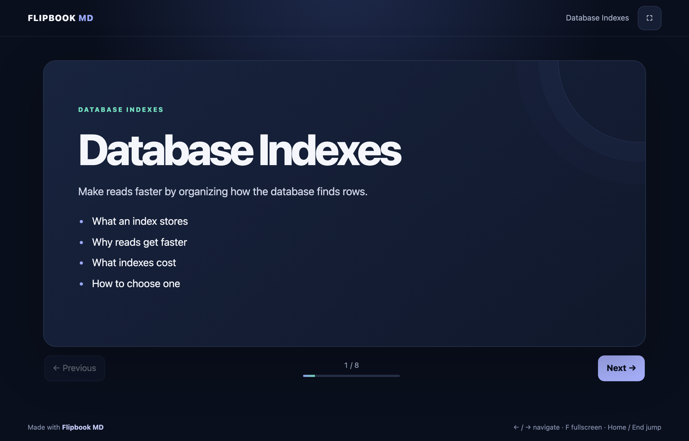
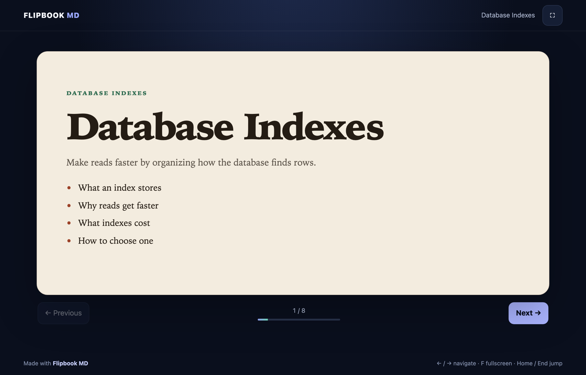
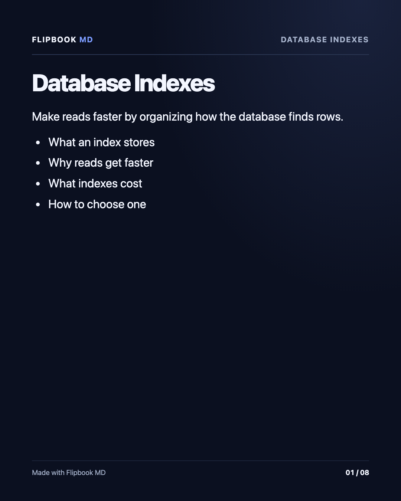
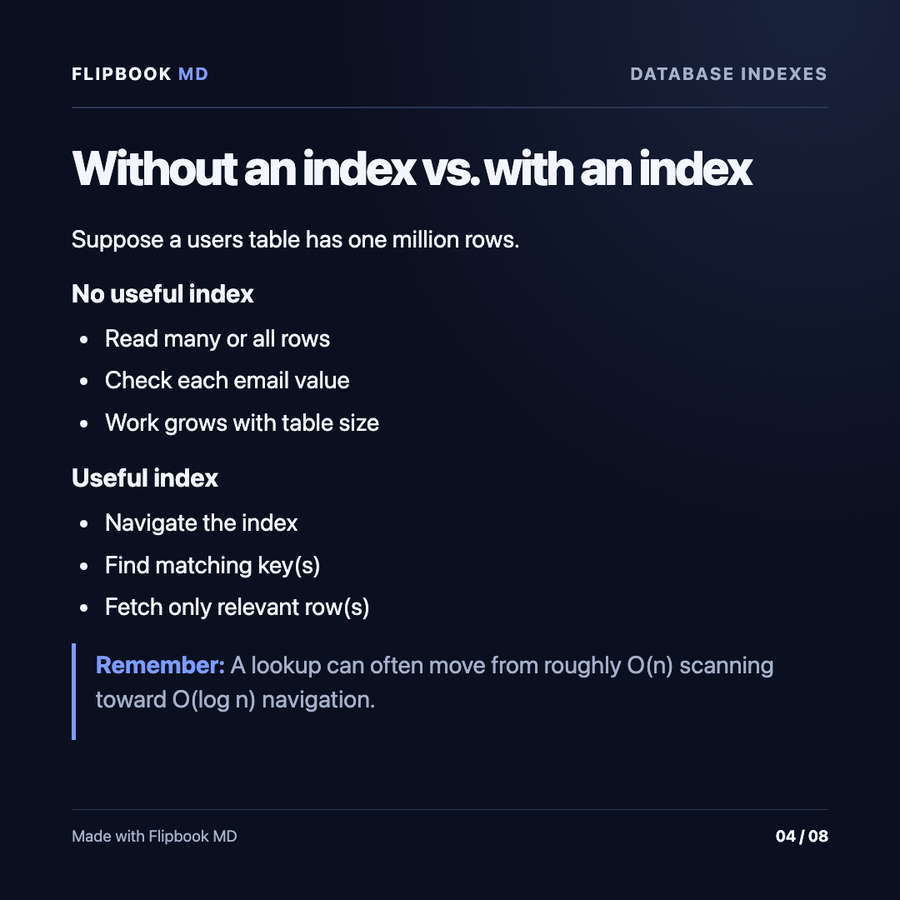

# Flipbook MD

[](https://github.com/uminocelo/flipbook-md/actions/workflows/ci.yml)

**Markdown in. Slides out.**

Flipbook MD is a local command-line tool. Point it at a Markdown presentation and it serves a slide player in your browser. The same source can be exported as numbered PNG images for an Instagram carousel or an X multi-image post.



The shot above is `examples/database-indexes-project` in the browser player.

Requires [Node.js](https://nodejs.org/) 20 or newer.

## Install

```sh
npm install -g flipbook-md
flipbook show .
```

`flipbook show` serves a presentation in the current directory. [Write a presentation](#write-a-presentation) describes the file format. Flipbook prints a `http://127.0.0.1` URL and tries to open it in your default browser. If it cannot, open the printed URL yourself. Press Ctrl+C to stop the server.

Exporting PNG images needs Chromium, installed once:

```sh
npx playwright install chromium
```

## Quick start from a checkout

Clone this repository, install dependencies, and open the sample talk:

```sh
npm install
npm start
```

`npm start` serves `examples/database-indexes-project` on a local URL, the same way `flipbook show` does.

To use the `flipbook` command from any directory while you work on this repository:

```sh
npm link
flipbook show examples/database-indexes-project
```

Without a global link, run the entry point directly:

```sh
node bin/flipbook.js show .
```

## Commands

| Command | What it does |
| --- | --- |
| `flipbook show [path]` | Serves the presentation on `127.0.0.1` and opens it in a browser. |
| `flipbook export [path]` | Writes one PNG per slide. |
| `flipbook --help` | Prints usage. |

Omit `path` to use the current directory. Both `show` and `export` accept:

- a `*.slide.md` file
- a directory that contains a `*.slide.md` file
- a directory that contains `presentation.yml`
- a path to `presentation.yml`

A directory with no manifest uses the first `*.slide.md` file in that directory, in sorted name order. Subdirectories are not searched.

## Write a presentation

### Single file

Name the file with a `.slide.md` suffix. YAML frontmatter is optional and sets the title and theme. A line that contains only `---` separates slides. The first separator is the `---` after the frontmatter.

```markdown
---
title: "My presentation"
theme: "midnight"
---

# Hello, world!

Markdown becomes a slide.

---

# Second slide

- Write familiar Markdown
- Separate slides with a line containing only `---`
```

```sh
flipbook show intro.slide.md
```

### Directory

Use one Markdown file per slide and list those files in `presentation.yml`.

```text
my-talk/
├── presentation.yml
├── presentation.css
├── assets/
│   └── diagram.png
└── slides/
    ├── 01-intro.slide.md
    └── 02-next.slide.md
```

`presentation.css` and `assets/` are optional. Slides use the built-in palette when the stylesheet is absent. A manifest may list any Markdown file inside the deck; `slides/NN-name.slide.md` is the convention. Existing decks that list `slides/01-intro.md` keep working.

```yaml
title: "My presentation"
theme: "midnight"
slides:
  - slides/01-intro.slide.md
  - slides/02-next.slide.md
```

```sh
flipbook show ./my-talk
```

Each slide path must stay inside the presentation directory. Flipbook rejects a manifest path that escapes the project, including a path that resolves outside it through a symlink.

The same directory can also hold one `<name>.slide.md` with every slide in a single file. `flipbook show` on the directory uses `presentation.yml` when that file is present.

### Images and other files

Put images, PDF, audio, and video in `assets/` at the deck root. In a slide, path them from that root:

```markdown


[Handout](assets/handout.pdf)
```

A path that starts with `./` is read next to that slide file. `https://` URLs stay as written. Flipbook serves these files with the deck and embeds images in exported PNGs. A file that resolves outside the deck is not served.

### Themes

`theme` may be `midnight` (the default), `light`, `paper`, or `forest`. Image export uses that palette for the slide when `presentation.css` is absent. Any other value falls back to `midnight`. The browser player’s page chrome uses its built-in dark appearance.

### Custom theme

Place `presentation.css` next to `presentation.yml`, or in the same directory as a `.slide.md` file. Flipbook applies it to the slide surface in the browser and in exported images.

```css
:host {
  --slide-bg: #f3ecdf;
  --slide-text: #241c14;
  --slide-muted: #5e564c;
  --slide-accent: #9c4228;
  --slide-mint: #2d6a4f;
  --slide-heading: #241c14;
  --slide-line: #e4d8c8;
  --slide-code: #fffaf3;
  font-family: "Iowan Old Style", Palatino, Georgia, serif;
}

:host::after { content: none; }
```

`:root` in this file is applied to the slide. These variables paint the surface:

| Variable | Role |
| --- | --- |
| `--slide-bg` | Background |
| `--slide-text` | Titles and default type |
| `--slide-muted` | Body copy |
| `--slide-accent` | List markers and links |
| `--slide-mint` | Eyebrow |
| `--slide-heading` | Third-level headings |
| `--slide-line` | Borders |
| `--slide-code` | Code background |

A solid background can hide the default ring with `:host::after { content: none; }`. Local fonts and images referenced with relative `url()` are read from the presentation directory (`.woff2`, `.png`, `.svg`, and the other common font and image types).

The previous button, next button, fullscreen button, and the keys ←, →, F, and Esc keep the player stylesheet. Esc leaves fullscreen.



## Present

The server binds to `127.0.0.1` and lets the operating system choose a free port.

| Key | Action |
| --- | --- |
| → or Space | Next slide |
| ← | Previous slide |
| Home / End | First or last slide |
| F | Toggle fullscreen |
| Esc | Leave fullscreen |

The on-screen buttons perform the same navigation.

## Export carousel images

Export renders each slide with [Playwright](https://playwright.dev/) and Chromium. Install that browser once, after the project dependencies:

```sh
npm install
npx playwright install chromium
```

```sh
# Instagram portrait, 1080 × 1350 (4:5)
flipbook export examples/system-design.slide.md --format carousel --preset instagram

# Square images for X, 1080 × 1080 (1:1)
flipbook export examples/system-design.slide.md --format carousel --preset x

# Choose the output folder
flipbook export . --format carousel --preset instagram --output dist/instagram
```

| Preset | Size | Shape | Intended use |
| --- | ---: | --- | --- |
| `instagram` | 1080 × 1350 | 4:5 portrait | Instagram carousel |
| `x` | 1080 × 1080 | 1:1 square | X multi-image post |

`--format` accepts `carousel`. The default preset is `instagram`, and the default output directory is `dist/carousel`.

Each file is named in slide order, for example `01-hello-world.png`. The folder also contains `README.txt`. Upload the images in numeric order, and check the platform’s current size and cropping rules before posting. Export leaves the source Markdown unchanged.

`npm run export:instagram` exports `examples/system-design.slide.md` with the Instagram preset.

These two frames are exported from `examples/database-indexes-project`.

<p>
  
  
</p>

## Development

```sh
npm test
npm start
```

Tests use the Node.js test runner (`node --test`).

```text
bin/        CLI entry point
src/        discovery, Markdown rendering, HTTP server, image export
public/     browser player
examples/   sample presentations
docs/       README screenshots
test/       automated tests
```

`node_modules/` and generated files under `dist/` are gitignored.

## Security

Flipbook is for local authoring. The server listens on loopback only. Rendered Markdown is sanitized before it is sent to the browser, and manifest slide paths cannot leave the presentation directory. Keep this server off untrusted networks.

## Status

Version 0.1.0 includes presentation discovery, Markdown slides, a browser player, optional `presentation.css` themes, carousel PNG export, and tests.

This version does not include live reload, a visual editor, PowerPoint export, collaboration, or support for every Markdown extension.

## License

[MIT](LICENSE)
